JMXer
=======
JMX MBean의 Attribute및 Operation에 접근하기 위해서는 일반적으로 jconsole을 이용하며, 성능 프로파일링을 위해서도 visualvm과 같은 훌륭한 도구가 존재한다.
그러나 이와 같은 툴들은 GUI 기반의 툴이라 사용자 환경의 제약이 따른다.
예를 들어, PaaS(Container) 환경에서는 위와 같은 툴 사용에 어려움이 있을 수 밖에 없다.
JMXer는 가벼운 TUI/CLI 기반의 툴로, JMX MBean을 컨트롤하고 기본적인 성능 분석을 위한 샘플링 기능을 제공한다.
이를통해 JAVA 성능 이슈 발생시, 대상 프로세스에 빠르게 접속하여 분석할 수 있도록 한다. 


## Requirements
* OS : Linux, Windows
* JAVA Runtime
  * 기본 권장: JDK 17+ (`JMXer.jar`)
  * 레거시 호환: JDK 8+ (`JMXer-java8.jar`)
* Online(PID/NAME) 세션 공통 조건
  * JDK 실행 환경 필요 (JRE 불가)
  * 대상 JVM과 동일 OS 사용자 권한 권장
  * Java 9+ 대상 JVM Attach는 `JMXer.jar`(Java 17 실행) 사용 권장

## Java 런타임 선택 가이드
릴리스는 2개의 JAR로 제공한다.

1) `JMXer.jar`
- 실행 가능 JVM: Java 17+
- 권장 용도: 최신 운영 환경

2) `JMXer-java8.jar` (레거시 호환)
- 실행 가능 JVM: Java 8+
- 권장 용도: Java 8/11 런타임에서 실행이 필요한 환경

※ 원격 접속(`ADDRESS`)은 버전과 무관하게 사용 가능

## Getting Started
아래의 JAVA Archive 파일(jar)을 다운로드 한다.
* 기본 권장 (Java 17+) : [JMXer.jar](https://github.com/cool8519/JMXer/releases/download/v2.0.0/JMXer.jar)
* 레거시 호환 (Java 8+) : [JMXer-java8.jar](https://github.com/cool8519/JMXer/releases/download/v2.0.0/JMXer-java8.jar)

커맨드 창에서 아래와 같이 실행한다. 세부 ARGUMENT들은 Usage를 참고한다.
```sh
$ java -jar JMXer.jar [ARGUMENTS]
```


## How to run
아래는 JMXer를 실행하기 위한 Agument 사용법이다.
옵션은 대소문자를 구분하지 않는다.

### 용어 (Terminology)
| 축 | 값 | 설명 |
| --- | --- | --- |
| **Session Mode** | Online / Offline | JVM 연결 여부 (`PID`/`NAME`/`ADDRESS` → Online, `DUMPFILE` → Offline) |
| **Interface Mode** | CLI / TUI | 풀스크린 UI(기본, `--tui`) 또는 텍스트 프롬프트 (`--cli`) |
| **UI Mode** (TUI만) | MBean / Thread / Record | TUI 작업 화면 |
| **Record View** (Record UI만) | Live / Dump | F4 토글(Online TUI). Live=실시간 JVM 쓰레드, Dump=수집 dump 쓰레드. Offline TUI(`DUMPFILE`)는 Dump View로 고정 |

```sh
$ java -jar JMXer.jar {PID=<pid> | NAME=<proc_name> | ADDRESS=<ip>:<port> [AUTH=<user>/<pass>] | DUMPFILE[=<dumpfile_path>]} [--cli|--tui]
```

JMXer를 실행하기 위해서는 두 가지 Session Mode를 사용할 수 있다.
- **Online** 세션 : 원격 또는 로컬 JAVA 프로세스에 연결하여 JMX 명령을 실행한다. 레코드 분석을 포함한 모든 기능을 사용할 수 있다.
    - Local : JMXer를 수행시킨 서버 내에서 실행중인 JAVA 프로세스에 직접 접속<br/>
        Ex 1) `$ java -jar JMXer.jar PID=12345`<br/>
        Ex 2) `$ java -jar JMXer.jar NAME=my.pkg.MyProgram`

        > 대상 JVM과 동일 OS 사용자 권한에서 실행해야 한다.

        > NAME은 유일하지 않으므로, 동일한 이름의 프로세스가 2개 이상인 경우는 임의의 프로세스로 접속될 수 있다.

    - Remote : 원격 서버에서 실행중인 JAVA 프로세스의 주소와 포트를 통해 접속. AUTH 옵션을 통해 jmxremote 인증을 수행할 수 있다.<br/>
        Ex 1) `$ java -jar JMXer.jar ADDRESS=192.168.1.100:10001`<br/>
        Ex 2) `$ java -jar JMXer.jar ADDRESS=192.168.1.100:10001 AUTH=myuser/mypass`

        > 로컬 JAVA 프로세스의 PID 및 NAME은 `"jps -l"` 명령을 통해 확인할 수 있다.

        > 원격 JAVA 프로세스에 접속하기 위해서는 기동시에 아래의 옵션이 적용되어 있어야 한다.<br/>
        > `-Dcom.sun.management.jmxremote`<br/>
        > `-Dcom.sun.management.jmxremote.port=[jmx remote port]`<br/>
        > `-Dcom.sun.management.jmxremote.ssl=false`<br/>
        > `-Dcom.sun.management.jmxremote.authenticate=false`

- **Offline** 세션 : JAVA 프로세스에 연결 없이 레코드 덤프 파일만 분석한다. Offline 세션에서는 JMX 명령을 실행할 수 없다.
    - DUMPFILE : Offline 세션으로 시작할 때 이 옵션을 사용. 파일명을 주면 자동으로 해당 파일을 로드<br/>
        `$ java -jar JMXer.jar DUMPFILE`<br/>
        `$ java -jar JMXer.jar DUMPFILE="/home/dump/JMXer_Record_Trace.dmp"`<br/><br/>

> Note: 모든 접속 옵션 뒤에 수행할 명령어를 나열할 수 있으며, 이를 생략하면 대화형 프롬프트로 실행된다.<br/>
`$ java -jar JMXer.jar PID=12345 @'./jmx_script.txt'`<br/>
`$ java -jar JMXer.jar ADDRESS=127.0.0.1:10001 CALL java.lang:type=Threading ThreadContentionMonitoringEnabled true`

## Interface Mode
- **TUI** (기본): Interface Mode 플래그를 생략하거나 `--tui`를 명시하면 풀스크린 터미널 UI로 동작한다.
- **CLI**: `--cli` 옵션과 함께 실행하면 텍스트 프롬프트(기존 방식)로 동작한다.

> Note: `--cli`와 `--tui`는 함께 사용할 수 없다.<br/>
> Note: `CommandLine_To_Execute`(inline 명령)가 있으면 항상 CLI로 비대화형 실행된다. `--tui`는 inline 명령과 함께 사용할 수 없다.

TUI는 CLI와 동일한 JMXer 명령을 **Command** 창에서 입력할 수 있으며, 상태·필터·목록·출력을 화면 창으로 나누어 보여준다. 단축키와 창 조작 방법은 TUI 화면의 상태 줄 및 내장 도움말에서 확인할 수 있다.

**키 리매핑**: **F12**로 현재 UI Mode·View·포커스 창에 해당하는 **Global** 단축키와 **Window** 단축키를 라이브 캡처 방식으로 재지정할 수 있다. 변경 사항은 현재 실행 세션에만 유지되며, 재시작 시 기본값으로 복귀된다.

### UI Mode (TUI 전용)
UI Mode는 TUI 작업 화면을 전환하는 축이다. Online TUI에서는 **MBean → Thread → Record** 순으로 순환된다. **Offline TUI**(`DUMPFILE`)는 **Record UI Mode**의 **Dump View**로 시작하며, 다른 UI Mode나 Live View로 전환할 수 없다.

- **MBean**: MBean ObjectName 목록과 Attribute/Operation(Features)을 탐색한다. CLI의 `OBJECT`/`LIST`/`CALL` 흐름과 동일한 작업을 GUI로 수행한다. Online 세션에서만 동작한다.

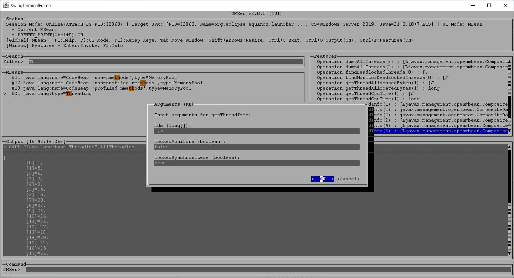

- **Thread**: 대상 JVM의 Thread 목록을 조회·필터하고, 선택한 Thread의 Stacktrace를 Output에 출력한다. 실시간 쓰레드 상태 모니터링에 적합하다. Online 세션에서만 동작한다.

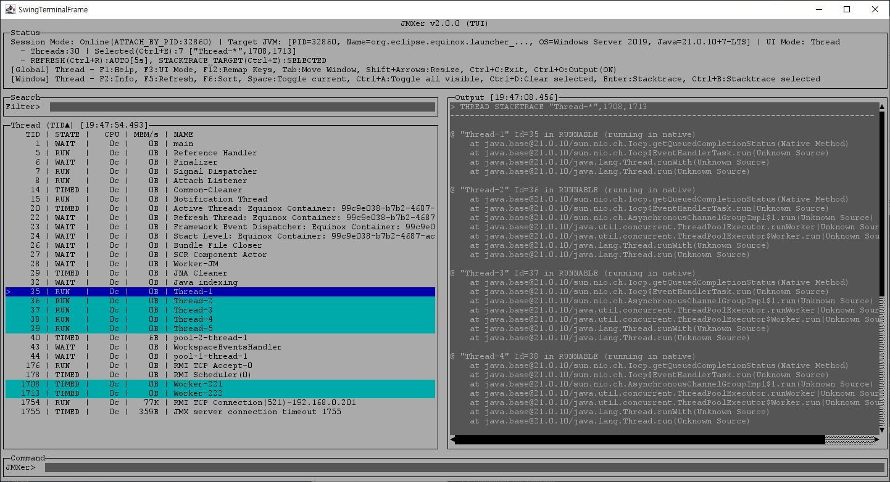

- **Record**: 대상 쓰레드를 조회·선택하고 스택트레이스 샘플링을 수행한다. Offline/Online 세션 모두 사용할 수 있다(스택트레이스 샘플링은 Online만). `RECORD VIEW` 등 기타 Record 명령은 Command Pane에서도 사용할 수 있다.
  - **Live View**: 실시간 JVM 쓰레드 목록을 표시한다. Online TUI에서만 사용하며, 실시간 모니터링과 샘플링 시작에 적합하다.

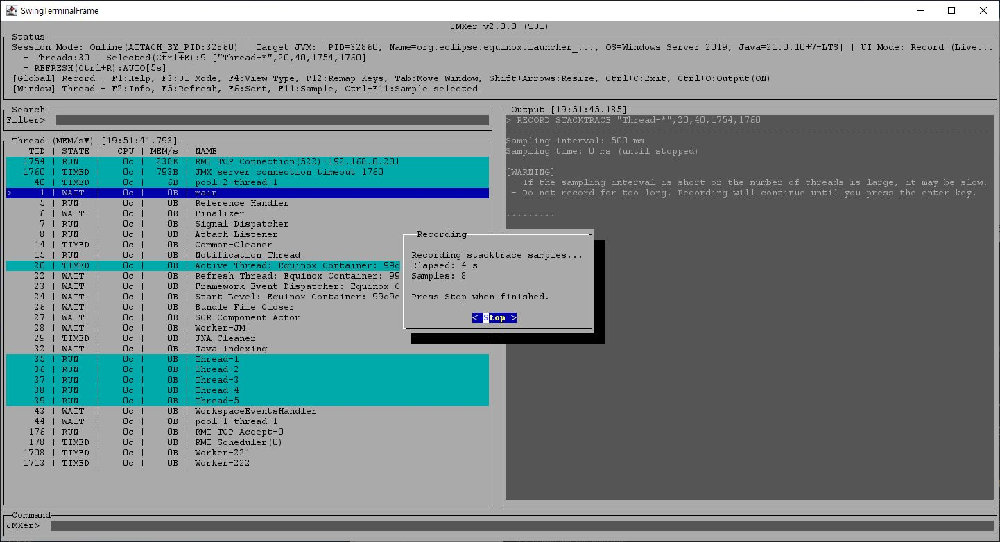

  - **Dump View**: 마지막 샘플링 결과 또는 불러온 덤프의 쓰레드 목록을 표시한다. `RECORD VIEW` 계열 분석·덤프 로드/저장에 적합하다. Offline TUI는 이 View로 고정된다.

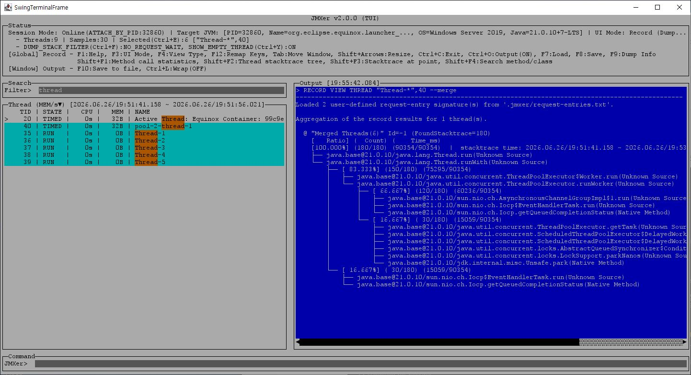


## Commands
모든 명령어는 대소문자를 구분하지 않는다.
명령어 중 대괄호(`[]`)안의 문자는 일부 또는 전체 생략이 가능하다. 예를들어 명령어 "Q[UIT]"에 대해서는 `Q`, `QU`, `QUIT`와 같이 입력할 수 있다.
> 복합 명령어 : 세미콜론(`;`)으로 구분된 여러개의 명령줄을 한번에 입력할 수도 있다.

#### 일반 명령어
다음과 같은 명령어를 사용할 수 있다.

| 기능 | 명령어 | 설명 |
| ------ | ------ | ------ | 
| 도움말 | `HELP` | 도움말을 출력한다.<br/>전체 도움말 및 명령어별 도움말도 확인 가능 |
| 종료 | `EXIT`, `Q[UIT]`, `B[YE]` | 프로그램을 종료한다. |
| 화면 지움 | `CLEAR` | 화면을 지운다. |
| 설정 | `SET` | JMXer내 환경변수를 확인하고 설정한다. |
| 수행 이력 | `HI[STORY]` | 수행한 명령줄 이력을 확인한다.<br/>최대 50개까지 저장 |
| 명령줄 편집 | `ED[IT]` | 이전에 수행한 명령줄을 편집한다.<br/>history내 명령줄 편집도 가능<br/>Windows만 지원 | 
| 재수행 | `PRE[VIOUS]`, `/` | 바로 이전에 수행한 명령줄을 재수행한다.<br/>history 목록내 명령줄도 수행할 수 있다. |
| 외부 명령 | `EXT[ERNAL]`, `!` | 외부 OS 명령어를 수행한다. |
| 스크립트 | `SCRIPT`, `@`, `<` | 명령어 목록이 나열된 스크립트 파일을 수행한다. |
| 대기 | `SLEEP`, `WAIT` | 명령어 입력을 잠시 대기시킨다.<br/> 스크립트 파일 또는 복합 명령어 내에서 사용 | 
| 결과 저장 | `SCRIPT`, `>` | 명령어 수행 결과를 파일에 저장한다. |

#### JMX 명령어
다음과 같은 명령어를 사용할 수 있다.
> Offline 세션에서는 `INFO`와 `RECORD` 명령어 사용만 가능하다.

| 기능 | 명령어 | 설명 |
| ------ | ------ | ------ | 
| 정보 | `INFO` | JMXer 및 연결된 JAVA 프로세스의 정보를 보여준다. |
| ObjectName | `OBJ[ECT]` | MBean ObjectName을 설정한다.<br/>설정되면 `LIST` 및 `CALL` 사용시 해당 ObjectName 하위로 한정된다. |
| 목록 | `LS`, `LIST` | MBean 또는 MBean 하위 Attribute/Operation을 보여준다. |
| JMX 호출 | `CALL` | MBean Attribute를 조회/저장하거나, Operation을 수행한다. |
| 쓰레드 | `THR[EAD]` | 쓰레드 정보(목록,상태,스택트레이스)를 보여준다. |
| 레코딩 | `REC[ORD]` | 쓰레드의 상태 변화를 저장하고 분석한다. |

##### 1. 목록 조회
목록 조회를 위해서 `LIST` 또는 `LS` 명령어를 사용한다.
`LIST`는 상황에 따라 다른 결과를 출력한다.
- 인자값이 없는 경우
    - Object값이 설정된 경우 : 해당 MBean의 Attribute와 Operation 목록 출력
    - Object값이 설정되지 않은 경우 : 전체 MBean 목록을 출력
- 인자값이 있는 경우 : 해당 MBean 위치로부터 상대경로의 목록 출력<br/>
    Ex 1) `JMXer> LS ../*Memory*`<br/>
    Ex 2) `JMXer> LS java.lang:type=Threading/*Count`

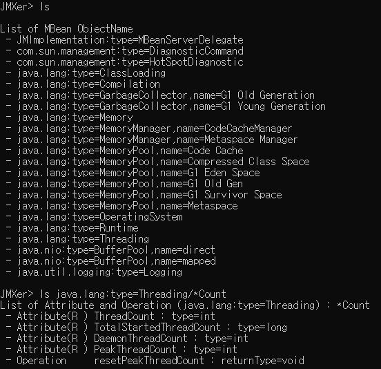

##### 2. JMX 호출
JMX 호출을 위해서 `CALL`명령어를 사용한다.
ObjectName은 `OBJECT`명령어를 통해 설정이 되어 있는 경우에 한해 생략이 가능하다.

###### 2.1 MBean 조회
아래와 같이 특정 MBean에 대한 정보를 조회한다.
```sh
JMXer> CALL [{*|ObjectName}] {?|??|#}
```
- `?` : Attribute와 Operation의 목록 출력
- `??` : Attribute와 Operation의 상세 정보 출력 
- `#` : 모든 Attribute값 출력

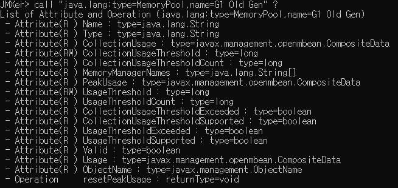

###### 2.2 MBean Attribute 조회/변경
아래와 같이 MBean내 특정 Attribute 값를 조회하거나 변경한다.
```sh
JMXer> CALL [{*|ObjectName}] AttributeName [{?|AttributeValue}]
```
- `?` : 해당 Attribute의 상세 정보 출력
- Value : 해당 Attribute 값을 Value로 변경

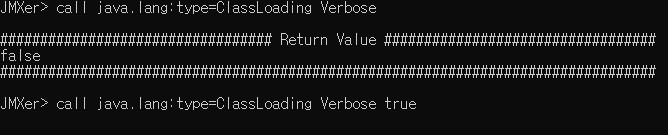

###### 2.3 MBean Operation 조회/호출
아래와 같이 MBean내 특정 Operation의 정보를 조회하거나 호출한다.
```sh
JMXer> CALL [{*|ObjectName}] OperationName [{?|ArgumentList}]
JMXer> CALL [{*|ObjectName}] OperationName(type1,type2,...) [{?|ArgumentList}]
```
- `?` : 해당 Operation의 상세 정보 출력
- **OperationName** : Operation 이름. 오버로드가 있으면 `OperationName(type1,type2,...)`와 같이 명시할 수 있다.
- **ArgumentList** : 파라미터가 복수개 일 경우는 값을 쉼표(`,`)로 연결하여 입력한다. (ObjectName·OperationName 다음은 공백 기준 토큰 1개만 허용)
  - `[a,b,...]` : 배열 파라미터 표현 (원소 사이 콤마 구분)
  - `"..."` : 공백·콤마가 들어가는 문자열 값을 감쌀 때 쌍따옴표 사용 (인자 목록 전체를 따옴표로 감싸지 않도록 주의)
  - 무인자 Operation : ArgumentList 없이 호출

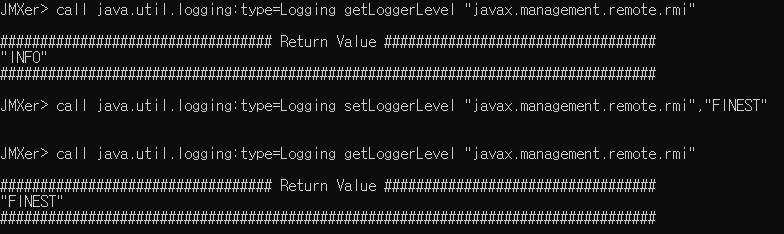

###### 2.4 MBean Knowledge Base
JMXer는 자주 사용하는 MBean에 대한 설명·인자명·예시 값을 YAML Knowledge Base로 보관하고, 런타임 JMX 메타데이터와 병합하여 표시한다.

- **적용 위치**
  - CLI: `CALL ... ??`, `CALL ... Feature ?`
  - TUI: MBean/Feature Pane **F2** 상세 팝업, Attribute(write)/Operation 인자 입력 팝업
- **TUI 제목 `(KB)`**: Knowledge Base에서 해당 MBean/Feature에 설명·예시·인자명 등이 보강된 경우, 관련 팝업 제목에 `(KB)` 접미사가 붙는다. 예: F2 상세 `MBean (KB)` / `Feature (KB)`, Attribute write `Attribute value (KB)`, Operation 인자 `Arguments (KB)`. KB 기여가 없으면 접미사 없음.
- **우선순위**: JAR 내장 YAML > 런타임 JMX 메타데이터
- **번들 데이터 위치**: `knowledge/mbeans/*.yaml` (빌드 시 JAR에 포함)
- **소스 레지스트리 (JAR 미포함)**: `knowledge/sources/*.yaml` — YAML 작성·갱신 시 참고할 MBean 매핑·**Javadoc URL** 등 배경 정보. 제품별 파일이며, 대응하는 산출물은 `knowledge/mbeans/<제품>.yaml`이다. `manualCurationOnly: true` 주석이 있는 제품(WildFly, Kafka)은 공개 Java MBean interface Javadoc이 없어 `sources` 항목 없이 ObjectName 참조만 제공한다.

##### 3. 쓰레드
Thread 정보 조회를 위해서 `THREAD`명령어를 사용한다.

###### 3.1 쓰레드 목록 조회
아래와 같이 현재 동작중인 Thread의 목록을 조회한다.
```sh
JMXer> THR[EAD] [LIST] [ThreadList]
```
- 전체 Thread 목록을 출력하는 경우, 2개의 인자값을 모두 생략할 수 있다.
- ThreadList : 특정 Thread ID 또는 Name에 해당하는 목록을 출력한다. 이 경우는 `LIST` 서브 명령어를 생략할 수 없다.
    > [참고] **ThreadList 표현식**<br/>
    > `*`는 모든 쓰레드를 의미한다. 인자값 없이 수행하는 것과 동일하다.<br/>
    > 공백없이 콤마(`,`)로 여러개의 쓰레드를 지정할수 있다.<br/>
    > Thread ID는 숫자로 표현하며, 마이너스(`-`)로 범위를 표현할 수 있다.<br/>
    > Thread Name은 쌍따옴표(`""`)로 둘러쌓인 문자열로 표현하며, `*`와 `?`를 사용하여 패턴 표현이 가능하다.<br/>
    > Thread ID와 Name을 혼합하여 아래와 같이 사용할 수 있다.<br/>
    > Ex) `"main",11-20,"Worker-*"`

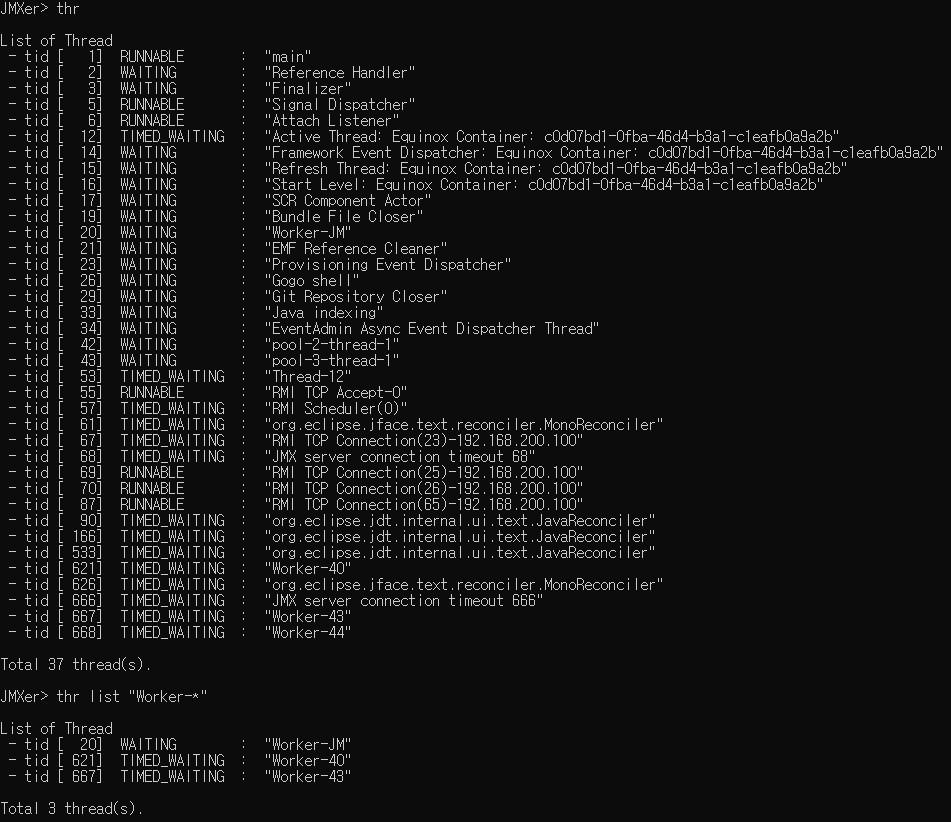

###### 3.2 쓰레드 상세정보 조회
아래와 같이 현재 동작중인 Thread의 상태 정보를 조회한다.
```sh
JMXer> THR[EAD] INFO ThreadList
```
- ThreadList : 특정 Thread ID 또는 Name에 해당하는 정보을 출력한다. *참고) ThreadList 표현식*

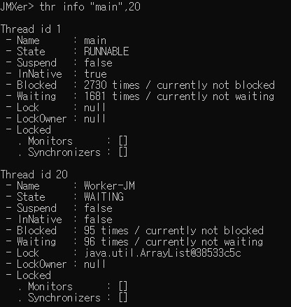

###### 3.3 쓰레드 스택트레이스 조회
아래와 같이 현재 동작중인 Thread의 StackTrace를 출력한다.
```sh
JMXer> THR[EAD] STACK[TRACE] ThreadList [MaxDepth]
```
- ThreadList : 특정 Thread ID 또는 Name에 해당하는 StackTrace을 출력한다. *참고) ThreadList 표현식*
- MaxDepth : 출력할 최대 Stack 깊이를 지정한다. 지정하지 않으면 전체 Stack을 출력한다.
- `SET STACKTRACE_TARGET` 설정에 따라 동작이 달라진다.
    - `SELECTED` (기본값): ThreadList로 해석된 Thread 전체를 출력한다.
    - `ACTIVE`: ThreadList로 후보 범위를 정한 뒤, 등록된 WAS/프레임워크 진입점 시그니처(화이트리스트) 및 `REQUEST_ENTRY_FILE`에 정의된 사용자 시그니처가 스택에 있는 Thread만 출력한다. RECORD용 이름 휴리스틱(`*Controller`, `*Service` 등)은 사용하지 않는다. (판별은 풀 스택으로 수행하고, 출력은 MaxDepth만큼 잘라 표시)
    - 예시) `JMXer> SET STACKTRACE_TARGET ACTIVE` 후 `JMXer> THREAD STACK *` — 전체 Thread 중 active만 출력

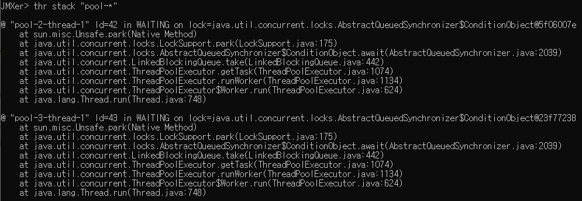

##### 4. 레코딩
현재 동작중인 Thread의 활동 변화를 샘플링하고 분석하기 위해서 `RECORD`명령어를 사용한다.

###### 4.1 쓰레드별 리소스 사용량 변화 추적
일정시간 동안의 Thread별 CPU 및 Memory 사용의 변화량을 확인할 수 있다.
```sh
JMXer> REC[ORD] RES[OURCE] ThreadList ↵
Sampling Time in milliseconds(0, Until the enter key is pressed):
```
- ThreadList : 수집할 Thread ID 또는 Name을 한정할 수 있다. *참고) ThreadList 표현식*
- Sampling Time : 모니터링 시간(ms). 0을 입력하면 <kbd>Enter</kbd>를 누를때 까지 모니터링 한다.

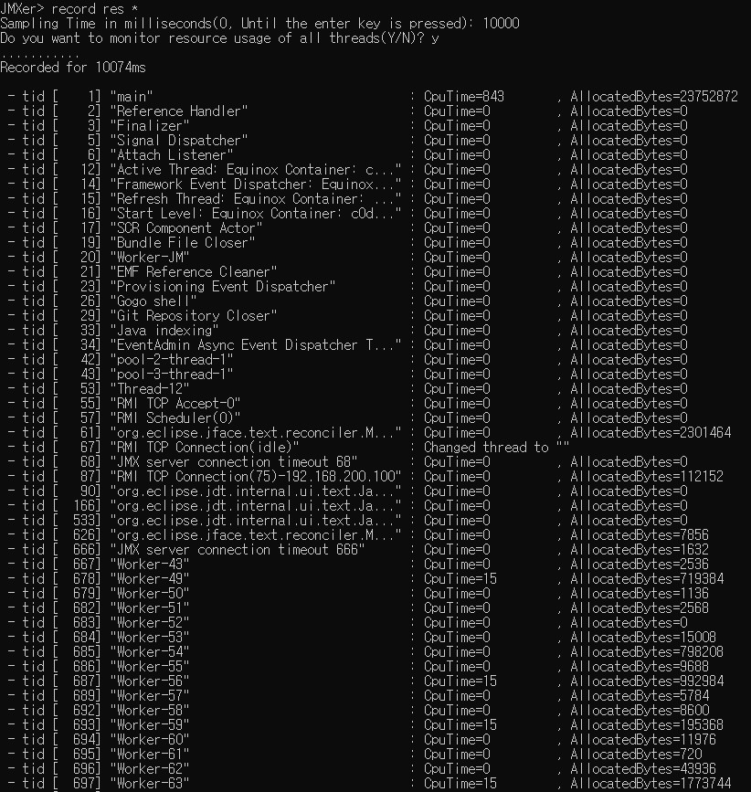

###### 4.2 쓰레드 스택트레이스 샘플링
일정간격으로 Thread내 Method 호출 변화를 기록한다.
```sh
JMXer> REC[ORD] STACK[TRACE] ThreadList ↵
Sampling Interval in milliseconds(500):
Sampling Time in milliseconds(0, Until the enter key is pressed):
```
- ThreadList : 수집할 Thread ID 또는 Name을 한정할 수 있다. *참고) ThreadList 표현식*
- Sampling Interval : 모니터링 간격(ms)
- Sampling Time : 모니터링 시간(ms). 0을 입력하면 <kbd>Enter</kbd>를 누를때 까지 모니터링 한다.
    > 주의:<br/>
    > Sampling Interval이 너무 길면 정확도가 떨어지며, 너무 짧으면 프로세스에 부하를 유발할 수 있다.<br/>
    > Sampling Time이 너무 길면 JMXer가 느려지거나 다운될 수 있다.

###### 4.3 스택트레이스 샘플링 저장
위에서 샘플링한 결과를 .dmp 파일로 저장한다.
```sh
JMXer> REC[ORD] SAVE [FileName]
```
- FileName : 저장할 dmp 파일의 절대 또는 상대 경로. 지정하지 않으면 현재 디렉토리에 저장되며, 파일명이 주어지지 않으면 기본 파일명인 "JMXer_Record_Trace.dmp"으로 저장된다.

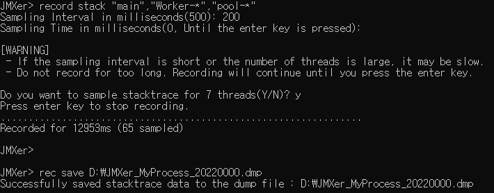

###### 4.4 스택트레이스 샘플링 로드
위에서 저장한 .dmp 파일을 메모리에 로딩한다.
```sh
JMXer> REC[ORD] LOAD [FileName]
```
- FileName : 로딩할 dmp 파일의 절대 또는 상대 경로. 지정하지 않으면 현재 디렉토리에서 로딩하며, 파일명이 주어지지 않으면 기본 파일명인 "JMXer_Record_Trace.dmp"를 로딩한다.

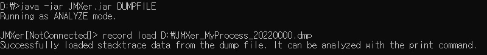

###### 4.5 스택트레이스 샘플링 분석
메모리에 로딩된 샘플링 결과를 분석한다. 이를 위해서는 스택트레이스 샘플링 또는 덤프 파일 로드를 먼저 수행해야 한다.
```sh
JMXer> REC[ORD] VIEW ViewType [ViewTypeArgs...]
```
- `RECORD VIEW` 출력 필터는 `SET DUMP_STACK_FILTER` 설정값을 따른다.
    - `NO_REQUEST_WAIT` (기본값): 요청 대기 상태 스택을 분석 모수에서 제외. 이때 ACTIVE/WAITING_REQUEST 분류는 **view 시점**에 수행하며, 내장 request-entry 시그니처와 현재 `REQUEST_ENTRY_FILE` 설정을 함께 사용한다.
    - `FULL`: 모든 스택을 분석 모수에 포함
    - 예시) `JMXer> SET DUMP_STACK_FILTER FULL`
- ViewType : 분석을 위한 세부 명령어로, 아래와 같이 사용할 수 있다.
    - `INFO` : 저장된 Sampling 결과를 요약하여 보여준다.<br/>
        Usage) JMXer> RECORD VIEW **INFO**
        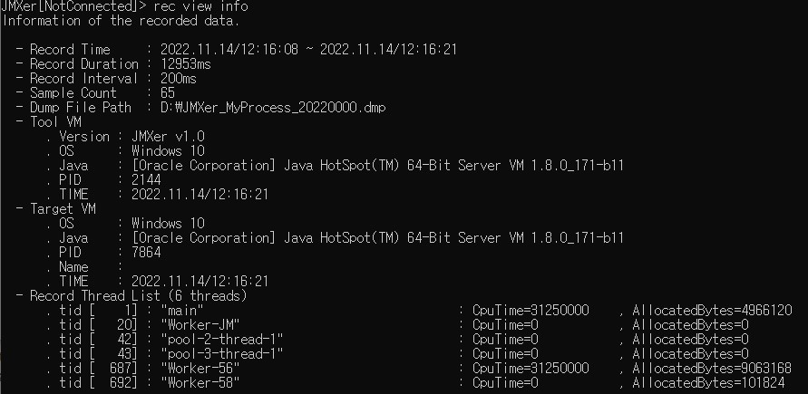
    - `METHOD` : Thread들에서 수행된 모든 Method를 호출 결과를 집계하여 점유율 순으로 보여준다.<br/>
        Usage) JMXer> RECORD VIEW **METHOD** *ThreadList [RangeExpression]*
        (출력 가독성을 위해 상위 Method 통계와 하위 line/ThreadList 통계를 계층적으로 구분해 표시한다.)<br/>
        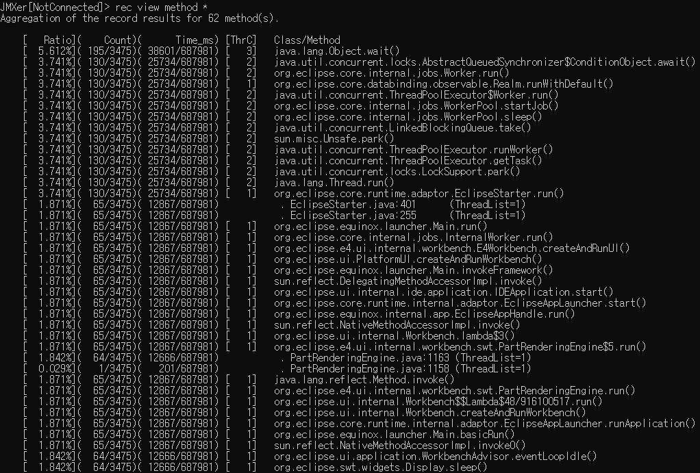
    - `THREAD` : Thread별로 Method 호출 결과를 집계하여 트리 형태로 보여준다.<br/>
        Usage) JMXer> RECORD VIEW **THREAD** *ThreadList [RangeExpression] [--merge\|--split]*<br/>
        (`--split` 기본값: Thread별 트리 출력, `--merge`: 대상 Thread들을 하나의 통합 트리로 출력)
        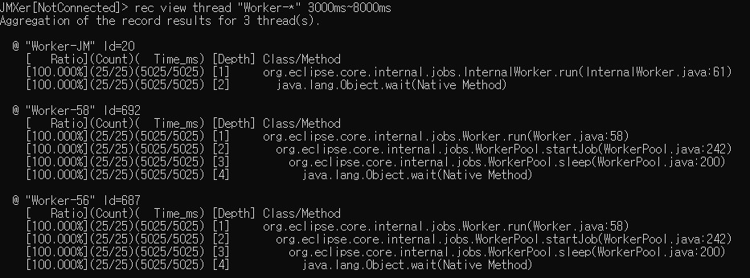
    - `STACK` : 특정 시점의 Thread StackTrace를 보여준다.<br/>
        Usage) JMXer> RECORD VIEW **STACK** *ThreadList PointExpression*
        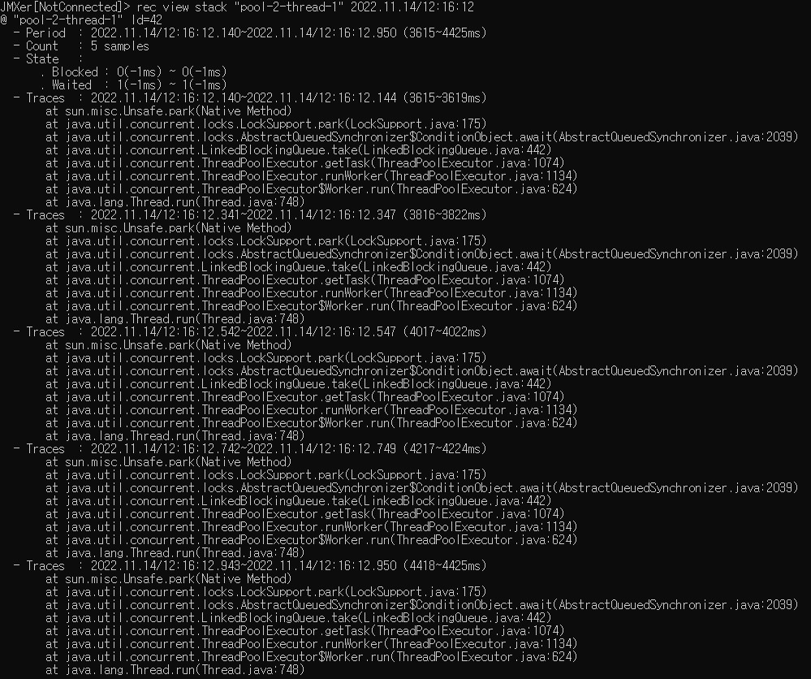
    - `SEARCH` : Sampling 결과 내에서 Method 또는 Class 호출 정보를 검색한다.<br/>
        Usage) JMXer> RECORD VIEW **SEARCH** *ThreadList NameExpression*<br/><br/>
        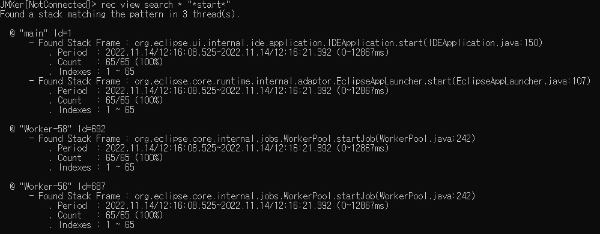

    > ThreadList : 분석할 Thread ID 또는 Name의 목록을 지정한다. 참고) ThreadList 표현식<br/>
    > TargetThread : 분석할 Thread ID(숫자) 또는 Name(문자열,패턴가능)을 지정한다. <br/>
    > RangeExpression : 분석할 시간 범위를 지정한다. 참고) Point/Range Expression 표현식<br/>
    > PointExpression : 분석할 시점을 지정한다. 참고) Point/Range Expression 표현식<br/>
    > NameExpression : 검색할 Method 또는 Class Name(문자열,패턴가능)을 지정한다.<br/>
        
    > [참고] **Point/Range Expression 표현식**<br/>
    > 절대 시간 : `yyyy.MM.dd/HH:mm:ss` 형식으로 표현 가능. Ex) 2022.10.28/12:35:00<br/>
    > 상대 시간 : 샘플링이 시작된 시간부터 상대시간을 `0000ms` 형식으로 표현 가능. Ex) 350ms<br/>
    > 샘플 순서 : 샘플링된 StackTrace 인덱스를 숫자로 표현. Ex) 5<br/>
    > 범위(Range)는 위 Point 표현식을 `~`로 연결하여 나타낸다.<br/>
    > Ex 1) 2022.10.28/12:35:00\~2022.10.28/12:35:10<br/>
    > Ex 2) 1000ms\~5000ms<br/>
    > Ex 3) 10\~20


## Release Note
### v1.0
 - 최초 릴리즈

### v1.0.1
 - ObjectName 선택시 Index 지원

### v1.1.0
 - (Bug) JAVA 9+에서 Attach시 모듈 시스템 접근 제약 오류 수정
 - (Bug) 파일명 및 명령어 인자값 전달시 따옴표 처리 방식 통일 및 오류 수정
 - (Bug) 외부 명령어 수행시 인자값 전달 오류 수정
 - 레코드 뷰의 stack 타입이 다수의 ThreadList를 지원하도록 변경
 - 레코드 뷰에서 요청 대기상태를 제외하는 NO_REQUEST_WAIT 모드 기능 추가
 - 레코드 뷰의 thread 타입에 통합 트리 출력 기능 및 옵션 추가
 - 레코드 뷰의 출력 가독성 개선

### v2.0.0
 - (Bug) CALL 인자 타입 검증 오류 수정
 - (Bug) 레코드 뷰의 thread 타입에 트리 통합 로직 오류 수정
 - TUI Interface Mode 지원 (기본 모드를 CLI에서 TUI로 변경)
 - Thread stacktrace 요청시 Active Thread만 출력하는 기능 추가
 - Active Thread 판별시 사용자 정의 Request Entry 등록 기능 추가
 - MBean Knowledge Base 추가
 - Attribute 조회 및 Operation 호출 가독성 개선
